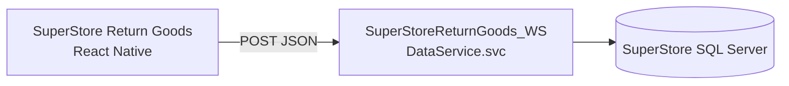

# SuperStore Return Goods

The **Supplier Return Qty** screen of SuperStore (`FrmSupplierReturnQty`) as an Android app for the portable scanners: one screen, no login and no menu.

| Path | Role | Stack |
|------|------|--------|
| `PortablePOS/` | Android app **SuperStore Return Goods** (`com.superstorereturngoods`) | React Native 0.70 |
| `StockSearch_WS/` | Web service `SuperStoreReturnGoods_WS` (`DataService.svc`) | ASP.NET WCF (.NET 4.5, IIS) |
| `SuperStoreReturnGoods.sln` | Visual Studio solution of the web service | — |



## The screen

The app opens on four buttons:

- **View**: choose a supplier that has returns. Its returns are shown read-only, the box above them filters them, and tapping a line shows its details.
- **Add**: choose the supplier, then scan the items (keyboard-wedge scanner) or open the stock search with the barcode icon (Category / Items, all loaded once and filtered as you type; in Add the items open filtered by the supplier code, which can be deleted). Set the unit, return quantity, warehouse and remarks for each line. Lines can still be changed until they are saved.
- **Modify**: choose the supplier and its returns load. Change the quantities or remarks, or delete lines, then save.
- **Delete**: choose the supplier and its returns load. Saving deletes all of them.

The supplier list loads every active supplier and filters as you type. A line's stock per warehouse opens from its **Qty In Warehouses** button.

The return in progress is kept on the device. If the app closes before it is saved or cancelled, the app offers to restore it the next time it opens.

The service reproduces the queries of the SuperStore controllers: `SupplierReturnsController`, `StockItemsViews.GetItemForSuppRetTrx`, `StockUnitController`, `WarehousesController`, `SuppliersController` and `StockQtyTrx.UpdateStockQty`. Saving updates `tbl_SupplierReturns`, plus `Stk_Return1` and `Qty_Return`, in one transaction.

## Offline (device SQLite)

- On the home screen, use **Download** while online (includes qty in warehouses). **Online / Offline** and last download time are shown in the green footer.
- Offline **Add** saves returns on the device; **View / Modify / Delete** apply only to those saved returns.
- When back online, **Upload** on the home screen lists the saved returns (tap one to see it, read-only). **Upload** at the bottom of the list sends all of them, **Close** goes back.
- Download and upload go by pages of **5000 records**. The progress shows the records done out of the total (`GetOfflineCounts` gives it first), then **Worked for …s** in a message box when finished. The download shows one bar for the suppliers, one for the items and one for the qty in warehouses, each with its own count.
- **All or nothing.** A download fills copies of the tables, which replace the old ones in one transaction once every page is there. An upload sends the lines of every saved return to the server (`UploadReturnPage`, kept in the server's temp folder), then `CommitReturnUpload` saves all of them, for every supplier, in one transaction. The returns stay on the device until the commit is done.
- **Cancel** (button, X or back key) is possible until the last step (*Saving On The Device* / *Saving On The Server*). A download cancelled or failed keeps the last download; an upload cancelled or failed saves nothing on the server (`CancelReturnUpload` removes its pages). Uploading the same returns again never saves them twice.
- A return saved on the device is always saved back on the device, even when online. Returns loaded from the server (online Modify / Delete) can only be saved online.

Republish the web service after pulling changes: the app uses `GetOfflineCounts`, `GetOfflineItemsPage`, `GetOfflineStockPage`, `UploadReturnPage`, `CommitReturnUpload` and `CancelReturnUpload` (`GetOfflineWarehouseStock` is removed).

## Configuration

### App (`PortablePOS/src/configuration/AppSettings.js`)

These values are built into the APK and the user cannot change them. Edit the file and rebuild the APK to change them.

| Key | Meaning |
|-----|---------|
| `server` | IIS server of the web service (name or IP, `:port` when not 80) |
| `location` | SuperStore location code |
| `userCode` | User saved in the user stamps (`Sr_Ustmp`, `Qty_UStmp`), 4 characters at most |

### Web service (`StockSearch_WS/Web.config`)

`AppConnectionString` is the SuperStore database connection string, encrypted the same way as the services (`DecryptString` in `modCommon.vb`).

## Build and deploy

### Web service

1. Build `SuperStoreReturnGoods.sln` (Release).
2. On IIS, create the application **`SuperStoreReturnGoods_WS`** (app pool .NET 4.x, integrated) pointing to the published folder (`DataService.svc`, `Global.asax`, `Web.config`, `bin\`).
3. Test it with `POST http://{server}/SuperStoreReturnGoods_WS/dataservice.svc/Web/Ping`, which returns `{"PingResult":"Success"}`.

### App

```powershell
cd PortablePOS
npm install
cd android
.\gradlew assembleRelease
adb install -r app\build\outputs\apk\release\app-release.apk
```
